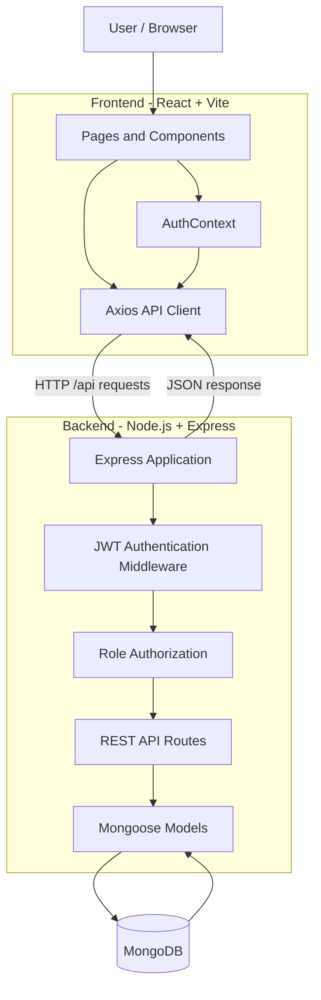

# ProStaff-HRMS(Human Resource Management System)

A web-based Human Resource Management System (HRMS) for handling common employee and HR workflows in one place. The current application includes role-based access for **Employees**, **Managers**, and **HR**, with modules for attendance, leave requests, announcements, training programmes, employee profiles, and user administration.

The project is organised as two independently installable applications:

- **`client/`** — React single-page application powered by Vite.
- **`server/`** — Node.js and Express REST API backed by MongoDB through Mongoose.

> **Project status:** This repository is an MVP / academic project implementation. It provides the core workflows described below, but it should be security-reviewed and extended before being used with real employee or company data.

---

## Table of Contents

- [Key Features]
- [User Roles and Permissions]
- [Project Architecture]
- [Technology Stack]
  - [Frontend]
  - [Backend]
  - [Database and Data Models]
- [Repository Structure]
- [Application Workflow]
- [REST API Reference]
- [Run the Project Locally]
- [Environment Variables]
- [Build the Frontend]
- [Current Limitations and Production Considerations]
- [Future Scalability and Roadmap]
- [Troubleshooting]
- [Contributing]

---

## Key Features

### 1. Authentication and Account Management

- User registration and login.
- Passwords are hashed with **bcryptjs** before being stored in MongoDB.
- The backend issues a **JSON Web Token (JWT)** after successful registration or login.
- The frontend attaches the token to protected API requests using an Axios request interceptor.
- The current user's details are refreshed from the API when the application loads.
- The first account registered in an empty database is automatically assigned the **HR** role. Later registrations receive the **Employee** role by default.

### 2. Role-Based Dashboard

The dashboard displays information relevant to the signed-in user's role, including:

- Today's attendance status.
- Number of the user's pending leave requests.
- Announcement count and the latest announcement.
- Number of available training programmes.
- Pending leave requests for users with a Manager or HR role.
- Team size for Managers.
- Total user count for HR.

### 3. Attendance Management

- Employees can check in and check out.
- Users can view their own attendance history.
- Managers can view attendance records for users assigned to them.
- HR can view attendance records across the organisation.
- A unique database index on the user and date combination prevents more than one attendance record from being created for the same user on the same stored date.

### 4. Leave Management

- Employees can submit casual, sick, earned, or unpaid leave requests.
- Employees can view their own leave history and request status.
- Managers can view pending requests for employees assigned to them.
- HR can view pending requests across the organisation.
- An authorised Manager or HR user can approve or reject a request.
- The backend creates a notification record when a leave request is approved or rejected. A notification inbox or read/unread interface is not yet included in the frontend.

### 5. Announcements

- All authenticated users can view announcements.
- Managers and HR can publish an announcement with a title and message.
- Announcements are ordered newest first and include their creator and creation date.

### 6. Training Programmes

- All authenticated users can view available training programmes.
- Managers and HR can create a programme with a title, description, and optional date.
- Employees and other authenticated users can enrol in a programme.
- The backend uses MongoDB's `$addToSet` update operator to avoid adding the same user to a programme more than once.

### 7. Employee Profile and HR Administration

- Users can update their name, phone number, and address.
- HR can view the registered users, change a user's name, department, role, and assigned manager, or delete a user.
- HR can assign employees to Managers, which is used to scope the Manager's team views.

---

## User Roles and Permissions

The application uses three role values: `employee`, `manager`, and `hr`.

| Capability                                   | Employee |    Manager     |        HR         |
| -------------------------------------------- | :------: | :------------: | :---------------: |
| View personal dashboard                      |   Yes    |      Yes       |        Yes        |
| View and update own profile                  |   Yes    |      Yes       |        Yes        |
| Check in / check out                         |   Yes    |      Yes       |        Yes        |
| View own attendance history                  |   Yes    |      Yes       |        Yes        |
| View team attendance                         |    No    | Assigned users | Organisation-wide |
| Apply for leave and view own requests        |   Yes    |      Yes       |        Yes        |
| View pending leave requests                  |    No    | Assigned users | Organisation-wide |
| Approve / reject leave requests              |    No    |     Yes\*      |        Yes        |
| View announcements                           |   Yes    |      Yes       |        Yes        |
| Create announcements                         |    No    |      Yes       |        Yes        |
| View and enrol in training                   |   Yes    |      Yes       |        Yes        |
| Create training programmes                   |    No    |      Yes       |        Yes        |
| Manage users, roles, and manager assignments |    No    |       No       |        Yes        |

\* The pending-request list shown to a Manager is filtered to that Manager's assigned users. The current status-update endpoint does not independently repeat that team-ownership check for a supplied leave-request ID; this should be enforced server-side before production use.

### Initial HR Account

When the MongoDB database contains no users, the first successful registration is assigned the `hr` role. Every later registration is assigned `employee`. The HR user can then open **Manage Users** to promote users to `manager` or `hr` and assign managers to employees.

There are no default usernames or passwords in the repository. For a fresh local database, create the first account through the Register screen and use it as the initial HR account.

---

## Project Architecture

The application follows a simple **client–server architecture**. The React client communicates with the Express API over HTTP. The API validates the request, applies authentication and role checks, and uses Mongoose models to read from or write to MongoDB.



### Architectural Layers

**1. Presentation layer — `client/src/`**

React pages render the user interface. React Router handles navigation, Bootstrap supplies the styling system, and the authentication context shares the signed-in user and authentication actions across the application.

**2. API communication layer — `client/src/api.js`**

A shared Axios instance uses `/api` as its base URL. A request interceptor reads the JWT from browser `localStorage` and adds it to the `Authorization: Bearer <token>` header when available. During local development, Vite forwards `/api` requests to the backend at `http://localhost:5000`.

**3. Application and routing layer — `server/server.js` and `server/routes/`**

Express parses JSON request bodies and registers route modules for authentication, users, attendance, leaves, announcements, and trainings. The error-handling middleware converts uncaught server errors into JSON responses.

**4. Security middleware — `server/middleware/auth.js`**

- `protect` checks the bearer token, verifies the JWT, loads the associated user, and attaches that user to the request.
- `authorize(...roles)` restricts a route to the listed roles.

**5. Data-access layer — `server/models/` and `server/config/db.js`**

Mongoose schemas define the application's collections, field types, references, timestamps, and selected indexes. The database connection is established using the `MONGO_URI` environment variable before the Express server starts listening.

### Typical Request Flow

1. A user performs an action in a React page, such as submitting a leave request.
2. The page calls the shared Axios client.
3. Axios adds the user's bearer token to the request, if one is stored.
4. Express receives the request and the route's `protect` middleware verifies the token.
5. Role-restricted routes also run the `authorize` middleware.
6. The route reads or updates the relevant Mongoose model.
7. Mongoose communicates with MongoDB.
8. Express returns a JSON response, and the React page updates its state and interface.

---

## Technology Stack

### Frontend

| Technology              | Version in project | Purpose                                                                            |
| ----------------------- | -----------------: | ---------------------------------------------------------------------------------- |
| React                   |          `^18.3.1` | Component-based UI and client-side state management.                               |
| React DOM               |          `^18.3.1` | Mounts the React application in the browser.                                       |
| React Router DOM        |          `^6.23.1` | Client-side routes, navigation, and protected page wrappers.                       |
| Vite                    |           `^5.3.1` | Development server, module bundling, and production build tooling.                 |
| `@vitejs/plugin-react`  |           `^4.3.1` | React support in Vite.                                                             |
| Axios                   |           `^1.7.2` | HTTP requests to the backend REST API.                                             |
| Bootstrap               |           `^5.3.3` | Responsive layout, navigation, forms, tables, cards, buttons, and utility classes. |
| JavaScript (ES modules) |                  — | Frontend application language and module system.                                   |
| HTML5                   |                  — | Browser entry document in `client/index.html`.                                     |

#### Frontend Design and Implementation

- **Component-based UI:** Reusable navigation and route-protection components are kept in `src/components/`.
- **Page-oriented organisation:** Each HRMS module has its own page component under `src/pages/`.
- **Shared authentication state:** `AuthContext.jsx` exposes the current user, loading status, login, registration, and logout actions through React Context.
- **Client-side routing:** `App.jsx` declares application routes using React Router. Pages are loaded with `React.lazy()` and displayed inside `Suspense` to defer page loading until needed.
- **Protected routes:** `ProtectedRoute.jsx` redirects unauthenticated users to login and redirects users without the required role to the dashboard.
- **Centralised API calls:** `api.js` configures the Axios instance and provides a common error-message helper.
- **Styling:** Bootstrap CSS is imported once from `main.jsx`; page layouts use Bootstrap classes.

> Client-side route protection improves navigation and user experience, but it is not a substitute for backend authorization. The API must remain the authority for every protected operation.

### Backend

| Technology                      |     Version in project | Purpose                                                                                                              |
| ------------------------------- | ---------------------: | -------------------------------------------------------------------------------------------------------------------- |
| Node.js                         |                Runtime | JavaScript runtime for the backend server.                                                                           |
| Express                         |              `^4.19.2` | HTTP server, middleware pipeline, and REST API routing.                                                              |
| MongoDB                         |                      — | Document-oriented database for users, attendance, leaves, announcements, trainings, and notifications.               |
| Mongoose                        |               `^8.4.0` | MongoDB object modelling, schemas, references, queries, and indexes.                                                 |
| JSON Web Token (`jsonwebtoken`) |               `^9.0.2` | Signs and verifies authentication tokens.                                                                            |
| `bcryptjs`                      |               `^2.4.3` | Password hashing and password comparison.                                                                            |
| `express-validator`             |               `^7.1.0` | Request validation; currently applied to registration fields.                                                        |
| `dotenv`                        |              `^16.4.5` | Loads environment variables from `server/.env`.                                                                      |
| `cors`                          |               `^2.8.5` | Enables cross-origin requests. The current configuration allows all origins and should be restricted for production. |
| `nodemon`                       | `^3.1.0` (development) | Restarts the backend automatically when source files change.                                                         |

#### Backend Design and Implementation

- **REST API:** Feature-specific route files keep endpoints grouped by domain.
- **Authentication:** Passwords are hashed using bcryptjs. The API returns a signed JWT after registration or login.
- **Authorization:** Middleware checks the authenticated user's current role before allowing restricted operations.
- **Database access:** Route handlers use Mongoose models to query and update MongoDB documents.
- **Environment-based configuration:** Database URI, port, token secret, and token expiry are configured through environment variables.
- **Error handling:** A final Express error middleware returns JSON error messages for errors passed to it.

### Database and Data Models

The application uses MongoDB collections represented by the following Mongoose models:

| Model          | Main fields / relationships                                                      | Purpose                                                                                                   |
| -------------- | -------------------------------------------------------------------------------- | --------------------------------------------------------------------------------------------------------- |
| `User`         | `name`, `email`, `password`, `role`, `department`, `phone`, `address`, `manager` | Account, profile, role, and reporting relationship. `manager` references another user.                    |
| `Attendance`   | `user`, `date`, `checkIn`, `checkOut`, `status`                                  | A user's attendance record for a date. A unique compound index is defined on `{ user, date }`.            |
| `Leave`        | `user`, `type`, `from`, `to`, `reason`, `status`, `reviewedBy`                   | Leave applications and their approval state.                                                              |
| `Announcement` | `title`, `body`, `createdBy`                                                     | Organisation announcements and their creator.                                                             |
| `Training`     | `title`, `description`, `date`, `participants`, `createdBy`                      | Training programmes and enrolled user references.                                                         |
| `Notification` | `user`, `message`, `read`                                                        | Notification records associated with a user. Leave decisions currently create records in this collection. |

All models use Mongoose timestamps where configured, which adds `createdAt` and `updatedAt` fields.

---

## Repository Structure

```text
hrms-management-system-main/
│
├── README.md
├── .gitignore
│
├── client/                         # React frontend application
│   ├── index.html                  # Browser entry HTML
│   ├── package.json                # Frontend dependencies and npm scripts
│   ├── vite.config.js              # Vite config and development API proxy
│   └── src/
│       ├── main.jsx                # React entry point, router and providers
│       ├── App.jsx                 # Route definitions and lazy-loaded pages
│       ├── AuthContext.jsx         # Shared authentication state and actions
│       ├── api.js                  # Axios instance and API error helper
│       │
│       ├── components/
│       │   ├── Navbar.jsx          # Main navigation and logout control
│       │   └── ProtectedRoute.jsx  # Authentication and role-based page guard
│       │
│       └── pages/
│           ├── Home.jsx            # Landing page
│           ├── Login.jsx           # Login form
│           ├── Register.jsx        # Registration form
│           ├── Dashboard.jsx       # Role-aware summary dashboard
│           ├── Profile.jsx         # Personal profile view and update
│           ├── Attendance.jsx     # Check-in, check-out and attendance history
│           ├── Leaves.jsx          # Apply for leave and view own requests
│           ├── LeaveRequests.jsx   # Manager / HR leave review screen
│           ├── Announcements.jsx  # View and publish announcements
│           ├── Trainings.jsx      # View, create and enrol in training
│           └── ManageUsers.jsx     # HR user, role and manager administration
│
└── server/                         # Express backend application
    ├── .env.example                # Example environment configuration
    ├── package.json                # Backend dependencies and npm scripts
    ├── package-lock.json           # Locked backend dependency tree
    ├── server.js                   # Express app entry point and API mounting
    │
    ├── config/
    │   └── db.js                   # MongoDB connection through Mongoose
    │
    ├── middleware/
    │   └── auth.js                 # JWT authentication and role authorization
    │
    ├── models/
    │   ├── User.js                 # User schema and password hashing
    │   ├── Attendance.js           # Attendance schema and unique index
    │   ├── Leave.js                # Leave application schema
    │   ├── Announcement.js         # Announcement schema
    │   ├── Training.js             # Training programme schema
    │   └── Notification.js         # Notification schema
    │
    └── routes/
        ├── auth.js                 # Registration, login and current user
        ├── users.js                # Profile and HR user administration
        ├── attendance.js           # Attendance actions and records
        ├── leaves.js               # Leave application and review endpoints
        ├── announcements.js        # Announcement endpoints
        └── trainings.js            # Training and enrolment endpoints
```

---

## Application Workflow

### Authentication Workflow

1. A new user submits the registration form with name, email, password, and optional department.
2. The backend validates the registration fields and checks for an existing email.
3. The first account in an empty database is assigned `hr`; later accounts are assigned `employee`.
4. The `User` model hashes the password before it is saved.
5. The backend returns a JWT and basic user details.
6. The frontend stores the token and user details in `localStorage` and updates the authentication context.
7. On a later page load, the frontend calls `/api/auth/me` to refresh the user's details and role.

### Leave Approval Workflow

1. An employee submits a leave request.
2. The request is stored with `pending` status.
3. A Manager or HR user opens the pending leave requests screen.
4. The backend returns pending requests according to the user's role and manager relationship.
5. The reviewer approves or rejects a request.
6. The leave status and reviewer reference are updated, and a notification record is created for the applicant.

### Manager Assignment Workflow

1. The initial HR user opens **Manage Users**.
2. HR changes the appropriate user's role to `manager` and saves the record.
3. HR assigns employees to that Manager using the manager selector.
4. Manager team attendance and pending leave lists use the employee-to-manager relationship.

---

## REST API Reference

All endpoints are prefixed with **`/api`**. Except for registration and login, the routes below require a valid bearer token. The backend expects JSON request bodies where applicable.

### Authentication — `/api/auth`

| Method | Endpoint    | Access        | Description                                                                                        |
| ------ | ----------- | ------------- | -------------------------------------------------------------------------------------------------- |
| `POST` | `/register` | Public        | Create an account and return a JWT. The first account becomes HR; later accounts become employees. |
| `POST` | `/login`    | Public        | Verify credentials and return a JWT.                                                               |
| `GET`  | `/me`       | Authenticated | Return the currently authenticated user.                                                           |

### Users — `/api/users`

| Method   | Endpoint | Access        | Description                                                     |
| -------- | -------- | ------------- | --------------------------------------------------------------- |
| `GET`    | `/`      | HR            | List users, including populated manager names.                  |
| `GET`    | `/team`  | Manager, HR   | Return users whose `manager` field matches the signed-in user.  |
| `PUT`    | `/me`    | Authenticated | Update the current user's name, phone, and address.             |
| `PUT`    | `/:id`   | HR            | Update a user's name, role, department, and manager assignment. |
| `DELETE` | `/:id`   | HR            | Delete a user by ID.                                            |

### Attendance — `/api/attendance`

| Method | Endpoint    | Access        | Description                                                       |
| ------ | ----------- | ------------- | ----------------------------------------------------------------- |
| `POST` | `/checkin`  | Authenticated | Create today's attendance record with a check-in time.            |
| `POST` | `/checkout` | Authenticated | Add a check-out time to today's attendance record.                |
| `GET`  | `/me`       | Authenticated | Return the current user's attendance records.                     |
| `GET`  | `/team`     | Manager, HR   | Return attendance for assigned users (Manager) or all users (HR). |

### Leaves — `/api/leaves`

| Method | Endpoint      | Access        | Description                                                                                                                     |
| ------ | ------------- | ------------- | ------------------------------------------------------------------------------------------------------------------------------- |
| `POST` | `/`           | Authenticated | Submit a leave request.                                                                                                         |
| `GET`  | `/me`         | Authenticated | Return the current user's leave requests.                                                                                       |
| `GET`  | `/pending`    | Manager, HR   | List pending requests for assigned users (Manager) or all users (HR).                                                           |
| `PUT`  | `/:id/status` | Manager, HR   | Approve or reject the leave request identified by `id`. Request body: `{ "status": "approved" }` or `{ "status": "rejected" }`. |

### Announcements — `/api/announcements`

| Method | Endpoint | Access        | Description                                                          |
| ------ | -------- | ------------- | -------------------------------------------------------------------- |
| `GET`  | `/`      | Authenticated | List announcements, newest first.                                    |
| `POST` | `/`      | Manager, HR   | Publish an announcement. Expected fields include `title` and `body`. |

### Trainings — `/api/trainings`

| Method | Endpoint      | Access        | Description                                                                                  |
| ------ | ------------- | ------------- | -------------------------------------------------------------------------------------------- |
| `GET`  | `/`           | Authenticated | List training programmes.                                                                    |
| `POST` | `/`           | Manager, HR   | Create a programme. Expected fields include `title`, with optional `description` and `date`. |
| `POST` | `/:id/enroll` | Authenticated | Enrol the current user in a programme.                                                       |

---

## Run the Project Locally

Follow these steps to run the frontend and backend on your computer.

### Prerequisites

Install the following before starting:

- **Node.js 18.x or 20.x and later** (Vite 5 requires Node.js 18+ or 20+). For ongoing support, use a currently maintained LTS release and check the [official Node.js release schedule](https://github.com/nodejs/Release) before selecting a version.
- **npm**, which is included with Node.js.
- **MongoDB Community Server** running locally, or a MongoDB Atlas database URI.
- **Git** (only if cloning the repository).

Check that Node.js and npm are available:

```bash
node --version
npm --version
```

### 1. Get the Project

Clone the repository:

```bash
git clone <YOUR_REPOSITORY_URL>
cd hrms-management-system-main
```

Alternatively, extract the ZIP archive and open a terminal in the extracted `hrms-management-system-main` directory.

### 2. Start or Configure MongoDB

**Option A — Local MongoDB**

Install and start MongoDB Community Server. The default connection string in the example environment file is:

```text
mongodb://127.0.0.1:27017/hrms
```

The application connects to the `hrms` database. MongoDB will create the database and collections when the application first writes data.

**Option B — MongoDB Atlas**

Create an Atlas cluster, create a database user, allow your development IP address in the network access settings, and copy the connection URI. Put that URI in `MONGO_URI` in the next step. Do not commit database credentials to Git.

### 3. Configure the Backend Environment

Open a terminal in the project root, then run:

**macOS / Linux**

```bash
cd server
cp .env.example .env
```

**Windows PowerShell**

```powershell
cd server
Copy-Item .env.example .env
```

Open `server/.env` and configure the values:

```env
PORT=5000
MONGO_URI=mongodb://127.0.0.1:27017/hrms
JWT_SECRET=replace_with_a_long_random_secret
JWT_EXPIRES=7d
```

- `PORT` — port on which the Express API listens.
- `MONGO_URI` — local MongoDB or Atlas connection string.
- `JWT_SECRET` — private secret used to sign and verify tokens. Replace the example value with a long, random secret. Keep it private.
- `JWT_EXPIRES` — token lifetime. The default shown is seven days.

### 4. Install Backend Dependencies and Start the API

Run these commands from the `server/` directory:

```bash
npm install
npm run dev
```

The development script uses Nodemon and starts the API on:

```text
http://localhost:5000
```

The server connects to MongoDB before it begins listening. Keep this terminal open while using the application.

For a non-watch start, use:

```bash
npm start
```

### 5. Install Frontend Dependencies and Start React

Open a **second terminal** in the project root:

```bash
cd client
npm install
npm run dev
```

Vite starts the frontend at:

```text
http://localhost:5173
```

Open that address in your browser. The Vite configuration proxies requests beginning with `/api` to `http://localhost:5000`, so the frontend can call the backend without manually entering the API host during local development.

### 6. Create the First HR Account

1. Open `http://localhost:5173/register`.
2. Register the first account in the fresh database.
3. That account will automatically receive the `hr` role.
4. Log in and open **Manage Users** to change other users' roles and assign managers.
5. Register additional accounts as employees and use the HR screen to configure the organisation structure.

> The first-account rule depends on the database initially having zero user records. When testing with an existing database, registration will not create another HR account automatically.

### 7. Stop the Development Servers

Use `Ctrl + C` in each terminal to stop the Vite frontend and Express backend. MongoDB can remain running as a background service if you plan to use it again.

---

## Environment Variables

The backend reads these variables from `server/.env` through `dotenv`:

| Variable      | Required | Example                          | Description                                                |
| ------------- | :------: | -------------------------------- | ---------------------------------------------------------- |
| `PORT`        |    No    | `5000`                           | API listening port. Defaults to `5000` in the server code. |
| `MONGO_URI`   |   Yes    | `mongodb://127.0.0.1:27017/hrms` | MongoDB connection URI.                                    |
| `JWT_SECRET`  |   Yes    | `use-a-long-random-secret`       | Secret used to sign and verify JWTs.                       |
| `JWT_EXPIRES` |    No    | `7d`                             | JWT expiry duration. Defaults to `7d`.                     |

The frontend currently uses a relative `/api` base URL in `client/src/api.js`. Its local development API destination is configured in `client/vite.config.js`. There is no separate frontend API URL environment variable in the current implementation.

---

## Build the Frontend

To create an optimised frontend production build:

```bash
cd client
npm install
npm run build
```

Vite writes the generated static assets to:

```text
client/dist/
```

To preview the generated build locally:

```bash
npm run preview
```

**Deployment note:** The `/api` proxy in `vite.config.js` is a Vite development-server setting; it is not a complete production API deployment configuration. In production, configure a reverse proxy (for example, Nginx) to forward `/api` to the Express server, or update the frontend API configuration to use the deployed backend URL. Deploy the backend with its environment variables and a reachable MongoDB instance.

---

## Current Limitations and Production Considerations

The following points describe the current repository, not features that have already been completed:

1. **Token storage:** JWTs are stored in browser `localStorage`. Consider secure, HTTP-only cookies or another reviewed token-storage strategy, along with an appropriate CSRF design, for production.
2. **CORS policy:** The server currently calls `cors()` without an origin allowlist. Restrict accepted origins to the deployed frontend domain.
3. **Initial HR assignment:** The first-registration rule is convenient for a local prototype, but it can be unsafe in a public deployment. Use a controlled administrator bootstrap or invitation process and handle concurrent first registrations safely.
4. **Manager leave-review scope:** The pending-list endpoint filters requests by manager assignment, but the status-update endpoint currently checks the reviewer's role without confirming that the requested leave belongs to one of that Manager's assigned employees. Add object-level authorization before deployment.
5. **Input validation:** Registration uses `express-validator`; equivalent validation, sanitisation, and consistent error handling should be added to all write endpoints.
6. **Notifications:** Leave decisions create `Notification` documents, but there are no notification retrieval, read, or unread endpoints and no notification UI yet.
7. **Attendance rules:** Attendance records use a UTC-derived date string. The current application does not implement configurable company time zones, shifts, grace periods, automatic absence marking, or automatic half-day calculation. The `status` field supports `present`, `absent`, and `half-day`, but the current routes do not calculate all these states.
8. **Leave policy:** The current workflow does not implement leave balances, holiday calendars, overlapping-request detection, approval chains, or policy-specific limits.
9. **API hardening:** Add rate limiting, secure HTTP headers, request-size limits, audit logging, and production HTTPS configuration.
10. **Testing:** No automated test suite is included in the current repository. Add unit, integration, and end-to-end tests before relying on the application for business operations.
11. **Operational readiness:** Add structured logging, health checks, monitoring, backups, database migration/maintenance practices, and a documented recovery plan.
12. **Notification delivery:** The current notification record is stored in MongoDB only; email, push, or real-time delivery is not implemented.

Do not use the current MVP with real employee data until authentication, authorization, validation, privacy, and deployment controls have been reviewed and strengthened.

---

## Future Scalability and Roadmap

The existing separation between React pages, Express routes, middleware, Mongoose models, and MongoDB provides a reasonable base for future enhancements. The following roadmap can extend the project without requiring an immediate rewrite.

### Phase 1 — Reliability and Security

- Add comprehensive request validation and sanitisation to every endpoint.
- Enforce object-level permissions for Manager actions and test all role boundaries.
- Replace open registration with HR invitations or a controlled account-provisioning process.
- Restrict CORS, add Helmet, rate limiting, secure cookies where appropriate, and HTTPS.
- Add automated tests for authentication, attendance, leave approval, manager scoping, and HR administration.
- Introduce audit records for sensitive actions such as role changes, user deletion, and leave decisions.

### Phase 2 — Complete HR Workflows

- Build a notification centre with unread counts and read/unread actions; optionally add email notifications.
- Add leave balances, configurable leave policies, holiday calendars, and multi-level approvals.
- Add attendance correction requests, shift schedules, timezone support, late arrival rules, and monthly attendance summaries.
- Add employee search, filters, pagination, bulk import, and export to CSV or Excel.
- Add training categories, enrolment limits, completion status, attendance, feedback, and certificates.
- Add employee documents and profile fields with controlled access.

### Phase 3 — Maintainability and Performance

- Move business logic from route files into dedicated service modules.
- Add a central validation layer, reusable response formats, and API documentation (for example, OpenAPI / Swagger).
- Add pagination and filtering to list endpoints and create indexes based on real query patterns.
- Use database backups, monitoring, and performance profiling as data volume grows.
- Add caching for frequently read data where appropriate (for example, Redis).
- Add a background job queue for emails, reports, bulk imports, and scheduled attendance tasks.

### Phase 4 — Deployment and Organisational Scale

- Containerise the client and server with Docker and define local services with Docker Compose.
- Set up CI/CD to run linting, tests, and builds before deployment.
- Deploy the frontend and API behind HTTPS and a reverse proxy or API gateway.
- Use managed MongoDB with backups, monitoring, and an appropriate replica-set configuration.
- Add centralised logs, application metrics, tracing, and alerting.
- Consider splitting independently scaling domains into services only when traffic, team ownership, or operational needs justify the added complexity.

### Additional HR Modules to Consider

- Payroll, payslips, reimbursements, and tax documents.
- Recruitment, applicant tracking, interviews, and onboarding checklists.
- Performance reviews, goals, feedback, and appraisal cycles.
- Asset allocation and return tracking.
- Employee self-service document requests and HR helpdesk tickets.
- Workforce planning, department analytics, and management reports.

These are proposed extensions; they are not part of the current implementation.

---

## Troubleshooting

### Backend cannot connect to MongoDB

- Confirm the MongoDB service is running.
- Verify `MONGO_URI` in `server/.env`.
- For Atlas, check the database username/password, network access allowlist, and connection string.
- Restart the backend after changing environment variables.

### Frontend opens, but API requests fail

- Confirm the backend is running at `http://localhost:5000`.
- Confirm the Vite development server is running at `http://localhost:5173`.
- Check that `client/vite.config.js` still proxies `/api` to `http://localhost:5000`.
- Inspect the browser developer console and the backend terminal for the API error.

### Login fails after changing the JWT secret

Tokens signed with the old secret will no longer verify. Log in again after the backend is configured with the new secret. If an old token remains in the browser, log out or clear the application's local storage and sign in again.

### Registration says the email is already used

The email is already present in the connected MongoDB database. Use another email or remove the test account through the HR user-management interface or a controlled database operation.

### Port 5000 or 5173 is already in use

Stop the process using the port, or change the backend `PORT`. If the backend port changes, also update the proxy target in `client/vite.config.js` so `/api` requests reach the correct server.

---

## Contributing

Contributions and suggestions are welcome. A useful workflow is:

1. Fork the repository and create a feature branch.
2. Keep frontend pages, backend routes, models, and middleware organised by responsibility.
3. Validate input and enforce permissions on the backend for every new write operation.
4. Add or update tests for new behaviour and access-control rules.
5. Update this README when commands, environment variables, API routes, or project structure change.
6. Open a pull request with a clear summary and testing notes.

---
